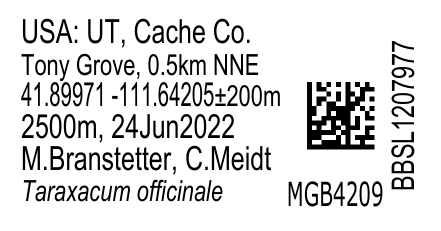
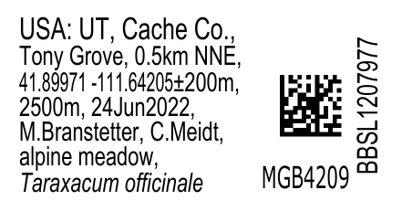
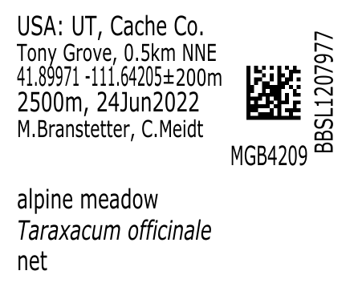
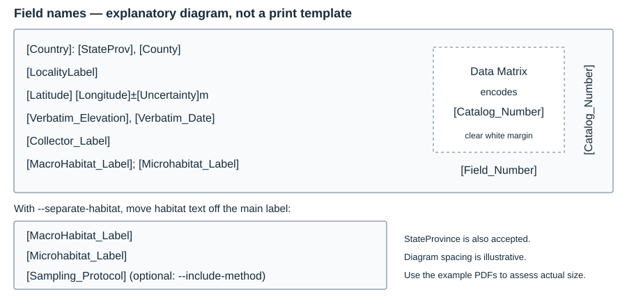
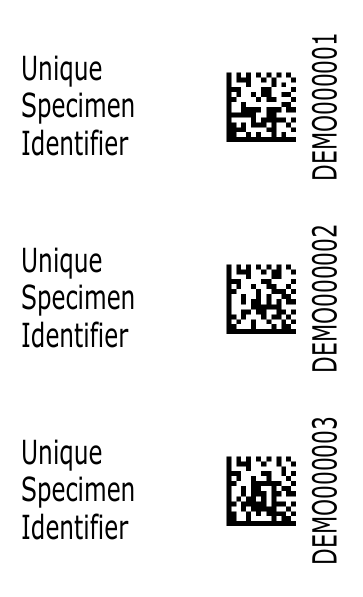
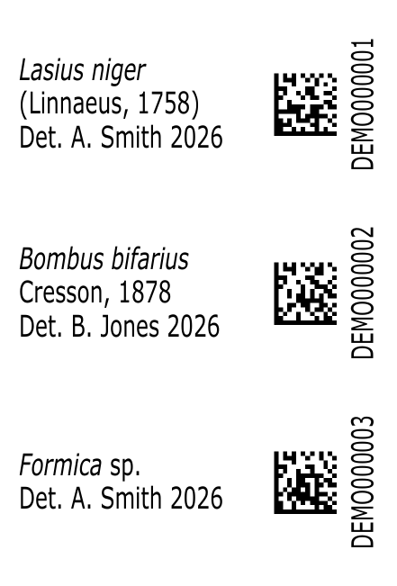

# Pittacia Insectorum

*Insect specimen labels from spreadsheets.*

Generate print-ready insect specimen labels from an Excel workbook. The program creates one label per specimen row, with locality and collection information, a vertically oriented catalog number, a Data Matrix barcode encoding that catalog number, and a collection-event code.

The tool runs locally, reads the workbook without changing it, and exports a US Letter PDF plus a JSON layout report. Text uses vector graphics with embedded fonts. All Data Matrix barcodes are embedded as 1200-dpi raster images in every label mode. Label text remains vector-based. Arial coordinates use 61% horizontal scale to preserve their preferred 4-point size where the data fit.

## Try all label options

Download the [printable seven-layout sampler](examples/label_options_sampler.pdf) and [filled example workbook](examples/label_options_examples.xlsx). Each layout has its own worksheet; the Instructions worksheet lists the corresponding command options. The sampler shows actual-size labels with light boundary guides. Six layouts use the real collection record BBSL1207977 / MGB4209, shared with permission; the determination layout remains explicitly fictional because no specimen determination was supplied. Catalog IDs are intentionally repeated across alternative layouts. The sampler notes any automatic fit-related omissions. Print at 100%, not Fit to page.

The [blank all-options workbook](templates/all_options_input_template.xlsx) contains matching empty worksheets. Select the worksheet with `--sheet`, and use the flags listed on its Instructions worksheet. These are alternative views of the same example records, not seven new specimen sets.

## Example labels

These enlarged previews use **BBSL1207977 / MGB4209**, a real Tony Grove collection record shared with permission. Download the PDFs for printing; do not print these enlarged PNG previews as labels.

| Separate lines | Wrapped text | Separate habitat + method |
| --- | --- | --- |
|  |  |  |
| [Print PDF](examples/sampler_real_lines.pdf) | [Print PDF](examples/sampler_real_flow.pdf) | [Print PDF](examples/sampler_real_method.pdf) |

The printed data include `USA: UT, Cache Co.`, `Tony Grove, 0.5km NNE`, coordinates `41.89971 -111.64205` with `±200m` uncertainty, `2500m, 24Jun2022`, and collectors `M. Branstetter, C. Meidt`. The separate habitat label shows `alpine meadow`, *Taraxacum officinale*, and optional method `net`. In the normal single-label example, macrohabitat is omitted by the documented fit fallback; the wrapped and paired examples retain it.

### Where each field goes



This diagram is deliberately enlarged and schematic. Bracketed names refer to Excel headers; they are replaced by cell values when generating labels. The default six-line layout is:

```text
[Country]: [StateProv], [County]
[LocalityLabel]
[Latitude] [Longitude]±[Uncertainty]m
[Verbatim_Elevation], [Verbatim_Date]
[Collector_Label]
[MacroHabitat_Label]; [Microhabitat_Label]
```

`[Catalog_Number]` is printed vertically and encoded in the matrix; `[Field_Number]` is the collection-event code beside it. With separate habitat labels, habitat moves to the second label, and `--include-method` optionally adds the sampling protocol. `StateProvince` is accepted as an alias for `StateProv`.

## Files to share

- `label_maker.py` — main Python script.
- `requirements.txt` — Python dependencies.
- `templates/label_input_template.xlsx` — blank Excel input with only the 14 printed/encoded label fields; header comments explain each field.
- `label_template.json` — editable field order and punctuation (not the Excel input template).
- `examples/` — fictional practice data plus the authorized real-record sampler, PDFs for the available layouts, and their reports.
- `README.md` — these instructions.

Send these files together. Do not copy your `.venv` folder; each user creates their own environment. Arial font files are not included. A ready-to-share copy of these files is available in `dist/insect_label_maker.zip`.

## Installation

Use Python 3.11 or newer. Extract the files into a folder, open a terminal there, and create a virtual environment.

**macOS / Linux:**

```sh
python3 -m venv .venv
source .venv/bin/activate
python -m pip install -r requirements.txt
```

**Windows PowerShell:**

```powershell
py -m venv .venv
.venv\Scripts\python.exe -m pip install -r requirements.txt
```

The commands below use `python`. On Windows, substitute `.venv\Scripts\python.exe`; on macOS/Linux you can use `.venv/bin/python` without activating the environment. Activate the environment again when opening a new terminal if using the short `python` command.

### Fonts

The program requires matching **Arial Regular** and **Arial Italic** TrueType font files, plus **Arial Bold** for the default field-block headings. It looks in `/System/Library/Fonts/Supplemental/` by default on macOS. On other systems, or if fonts are elsewhere, supply both paths:

```sh
python label_maker.py examples/example_specimens.xlsx --font "/path/to/Arial.ttf" --italic-font "/path/to/Arial Italic.ttf" --output output/example.pdf
```

Typical Windows paths are `C:\Windows\Fonts\arial.ttf` and `C:\Windows\Fonts\ariali.ttf`. Linux users must provide their own installed Arial files. Regular and italic fonts should come from the same family. Fitting accounts conservatively for differences in their character widths, including Verdana’s wider italic characters.

## Prepare the Excel file

Start with [the blank Excel template](templates/label_input_template.xlsx), or copy [the six fictional example specimens](examples/example_specimens.xlsx). The template columns are based on Symbiota field names, and the layout follows common insect collection-label conventions. Enter one row per label, repeating collection-event information as needed. Each row represents a uniquely identified cataloged unit, such as a pin or vial. Header comments provide examples.

Use an `.xlsx` workbook with column headers in the first row and one specimen per subsequent row. Column order does not matter; header spelling and capitalization do. Extra columns are ignored unless referenced in the template. The active worksheet is used unless `--sheet` selects another.

The supplied template uses these columns:

| Header | Purpose / example |
| --- | --- |
| `Catalog_Number` | Required, unique, nonempty specimen identifier, e.g. `DEMO000001`. Printed vertically and encoded in the barcode. |
| `Country` | Country name or abbreviation, e.g. `USA`. |
| `StateProv` or `StateProvince` | State/province abbreviation, e.g. `UT`. |
| `County` | County display text, e.g. `Cache Co.`. |
| `LocalityLabel` | Concise locality text, e.g. `Example Meadow`. |
| `Latitude` | Decimal latitude, e.g. `41.9`. |
| `Longitude` | Decimal longitude, e.g. `-111.65`. |
| `Uncertainty` | Numeric uncertainty in meters, e.g. `100`. May be blank; the template adds `±` and `m`. |
| `Verbatim_Elevation` | Elevation display text including units, e.g. `2500m`. The alternate spelling `Verbatium_Elevation` is also accepted. |
| `Verbatim_Date` | Collection date exactly as it should appear, e.g. `12Jul2026`. |
| `Collector_Label` | Concise collector names, e.g. `A. Smith, B. Jones`. Spaces after initials are removed for display. |
| `MacroHabitat_Label` | Broad habitat, e.g. `meadow`. May be blank. |
| `Microhabitat_Label` | Collection substrate, plant, or method, e.g. `Phacelia sp.` or `pan traps`. May be blank. |
| `Field_Number` | Optional collection-event identifier, e.g. `EVT001`, printed near the barcode. This column may be omitted. |

All template-referenced headers must exist, even when their cells are blank. `Catalog_Number` is always required, including with a custom template. Store identifiers as Excel **text** if leading zeros matter. Completely empty rows are skipped; other rows with a missing catalog number or duplicate catalog numbers are rejected. No extra copies are generated from specimen-count columns.

Keep the full scientific data in other columns and use the label-specific fields for concise wording. Text is not silently truncated. Formulas use their last saved calculated values: recalculate and save in Excel before importing. Text dates are preserved; actual Excel dates are formatted as `12/Jul/2026`. Coordinates retain up to 12 significant digits.

## Barcode-only and determination labels

| Generic barcode | Determination with barcode |
| --- | --- |
|  |  |

These modes need no collection/locality data. Each row still needs its own unique, preassigned `Catalog_Number`; the tool does not reserve numbers or assign the same barcode to multiple cataloged units. A cataloged unit may be a pin or vial rather than an individual insect.

### Small pin-barcode labels

```sh
python label_maker.py examples/example_barcodes.xlsx --mode pin-barcode --output output/pin_barcodes.pdf
```

This mode prints only the matrix and vertical **4-point Catalog Number**, with blank space to the left for a pin. The default is **0.32 × 0.30 inches**. It uses the same barcode scale as the main locality label (1.02), including the two-module white margin. At the default size the blank left area is about 0.107 inches (2.7 mm) wide; the tool requires at least 0.08 inches of pin space before the barcode margin. Keep the pin and its shadow clear of the barcode and quiet margin. No pinhole mark is printed. Use the [barcode input template](templates/barcodes_input_template.xlsx); only `Catalog_Number` is needed. [Printable pin-barcode example](examples/example_labels_pin_barcode.pdf).

### Generic barcode labels

Use [the barcode input template](templates/barcodes_input_template.xlsx), containing only `Catalog_Number`, or try [the fictional example](examples/example_barcodes.xlsx):

```sh
python label_maker.py examples/example_barcodes.xlsx --mode barcode --output output/barcodes.pdf
```

The default compact label is **0.55 × 0.30 inches**. It prints “Unique Specimen Identifier”, a centered Data Matrix barcode, and a vertical **4-point Catalog Number**. Field Numbers and event block headings are omitted even if those columns occur in the input. [Printable example](examples/example_labels_barcodes.pdf).

### Determination labels with barcodes

Use [the determination input template](templates/determinations_input_template.xlsx) with these columns:

| Column | Meaning |
| --- | --- |
| `Catalog_Number` | Required unique barcode payload and printed code. Reuse an existing code for an existing cataloged unit. |
| `Genus` | Required taxon genus. |
| `Species` | Required epithet or designation such as `sp.`. |
| `Author` | Optional taxon authority, e.g. `(Linnaeus, 1758)`. |
| `Determiner_Label` | Required display text, e.g. `A. Smith 2026`. |

```sh
python label_maker.py examples/example_determinations.xlsx --mode determination --output output/determinations.pdf
```

The default is **0.68 × 0.33 inches**, with the taxon and authority followed by `Det.` and the determiner. If the taxon and authority do not fit together, the authority starts on a new line rather than sharing the genus/species line. Longer names or authorities can wrap further as needed. `Det.` is added automatically unless already present. Genus/species are italic; `sp.`, `spp.`, `indet`, authorities, and determiner text remain upright. Text wraps beside the barcode and is vertically centered. All text is 4 points; these modes stop with a fit error rather than shrink or omit determination information. [Printable example](examples/example_labels_determinations.pdf).

Generic barcode and determination modes default to **1.05 barcode scale** relative to the original 0.11-inch dark symbol, with quiet margins enlarged together, raster barcodes and vector text. The Catalog Number uses 65% horizontal scale at 4 points to fit compact labels. Use `--width`, `--height`, or `--barcode-scale` to override dimensions; width never exceeds 0.68 inch. Longer IDs or taxon names may need greater height or shorter display wording. `--guides` adds light cutting rectangles. `--omit-catalog-text` is an optional special-mode switch to hide the human-readable code only; the unique value is still required and encoded. These modes do not accept `--template` or `--separate-habitat`.

For existing collection labels and retroactive data entry, verify that the determination barcode matches the code already assigned to the pin/vial before printing.

### Optional method on the separate habitat label

```sh
python label_maker.py input.xlsx --separate-habitat --include-method --output output/labels_with_method.pdf
```

`--include-method` adds the sampling protocol after macrohabitat and microhabitat on the smaller label. It uses the first nonempty value from `Sampling_Protocol_Label`, `Sampling_Protocol`, or `Method`. At least one of those headers must be present; blank values add no method line. The text stays **4 pt**, left aligned, with the whole block vertically centered. The existing **three physical lines total** limit applies to all three fields together. Long fields can wrap, but a batch that needs more than three lines stops rather than omitting data. The default two-label mode is unchanged when this option is absent. [Printable example](examples/example_labels_habitat_method.pdf).

## Generate labels

After filling and saving a copy of the blank template:

```sh
python label_maker.py "my_specimens.xlsx" --output output/my_labels.pdf
```

The default layout uses all 14 fields from the Excel template. `label_template.json` is only needed when customizing field order or punctuation. The tool creates labels; it does not allocate catalog numbers, expand specimen counts, or create a complete Symbiota import file.

Normal layout with an explicit layout template:

```sh
python label_maker.py "/path/to/specimens.xlsx" --template label_template.json --output output/labels_lines.pdf
```

Wrapped layout:

```sh
python label_maker.py "/path/to/specimens.xlsx" --template label_template.json --layout flow --output output/labels_flow.pdf
```

Quote paths containing spaces. Use a different output filename for each batch: an existing PDF and JSON report at that path will be replaced. If a specimen cannot fit, generation stops and identifies its Excel row and catalog number; a partial batch is not exported.

### Layouts and fitting

Both layouts default to **0.68 × 0.33-inch labels**, with 0.02-inch horizontal/vertical gaps and 0.25-inch page margins. Labels fill down a column, then across the page, with automatic pagination. **Width must never exceed 0.68 inch**: labels are inserted vertically, and this limit allows four rows in a standard unit tray. Automatic widening is disabled. Height may be increased explicitly with `--height` (default `0.33` inch).

- **`lines` (default):** keeps the six template entries on separate lines. Entries 1–5 start at 4 points and individually fall back to 3.5 points if needed. Entry 6 stays at 3.5 points. The adaptive layout uses equal 3.8-point baseline spacing, independent of font size.
- **`flow`:** joins entries with commas and wraps them into a text column. Latitude/longitude and their uncertainty stay together as one unit, using the coordinate horizontal scale. If the unit cannot fit beside preceding text, it starts on the next line. It tries 4-point text first and 3.5 points when needed; physical lines containing habitat text use 3.5 points. Wrapped lines use their own flow spacing.

All main and habitat text stays behind an invisible boundary left of the barcode, including above and below it. Habitat text also stops at least 1.5 points before the actual Field Number, so long codes cannot crowd it. Catalog and field numbers have separate positions. The Data Matrix is vertically centered; catalog text is 3.75 points and field-number text defaults to 4 points. The Field Number uses Verdana when available, otherwise Arial, with its own 60% horizontal scale to stay clear of the main text and barcode. The Field Number is right-aligned in its reserved space. Habitat text on the main label has a stricter right boundary that guarantees at least 1.5 points of horizontal separation from the Field Number.

Text normally uses 75% horizontal scale. In the standard normal layout, latitude/longitude beside uncertainty uses 61% scale, and the uncertainty term is always 3.5 points. The coordinate line stays on line 3; elevation/date stay on line 4.

The program first tries to retain all information, then may omit coordinate uncertainty. For the standard habitat template, if the label still cannot fit, it tries microhabitat alone. It never automatically removes microhabitat. The JSON report records omitted uncertainty/macrohabitat, rendered lines, font sizes, positions, and text runs. Review that report when completeness matters. These fallbacks can differ between the two layouts.

Within `Microhabitat_Label`, recognizable genus/species combinations are italicized: *Phacelia* sp. or *Phacelia tanacetifolia*. `sp.`, `spp.`, family names such as Asteraceae, and descriptive text remain upright. Recognition uses name structure, not a taxonomic database; review unusual or abbreviated names.

### Text length while entering data

For the normal six-line layout, use these **approximate editing targets per complete ordinary text line**, including spaces and separators:

| Font | 4 pt | 3.5 pt |
| --- | --- | --- |
| Arial | About 20–23 characters | About 23–25 characters |
| Verdana | About 22–24 characters | About 24–27 characters |

These measured examples are **guidance, not hard limits**: wide letters can fit far fewer characters than narrow letters. Several fields may share one line. Coordinates use a separate compression setting; habitat is always 3.5 pt and may have a smaller text area. The tool measures actual rendered width and may reduce a line to 3.5 pt or apply its documented omission rules. Check the PDF and JSON report.

The blank Excel templates provide advisory header comments rather than character-count restrictions. See [text-length guidance](docs/text_length_guidance.md) for the assumptions, shared-line budgets, and examples.

### Command-line options

| Option | Default | Effect |
| --- | --- | --- |
| `excel` | Required | Input `.xlsx` path (positional argument). |
| `-o`, `--output` | `output/labels.pdf` | PDF path; JSON report uses the same basename. |
| `--barcode-rendering raster` | `raster` | Compatibility option; all barcode modes always use 1200-dpi raster images. |
| `--mode locality\|barcode\|determination\|pin-barcode` | `locality` | Choose collection, generic identifier, or determination labels. |
| `--omit-catalog-text` | Off | Hide printed catalog text in barcode/determination modes only. |
| `--barcode-scale FACTOR` | `1.02` locality; `1.05` special modes | Enlarge barcode and quiet margin together; range 1.0–1.1. |
| `--coordinate-scale FACTOR` | `.61` Arial / `.49` Verdana | Horizontal coordinate scale; font height unchanged. |
| `--label-rendering vector\|raster` | `vector` | Keep text vector-based, or rasterize entire labels with Poppler. |
| `--layout lines\|flow` | `lines` | Separate-line or comma-separated wrapped layout. |
| `--font-family arial\|verdana` | `arial` | Select matching main, catalog, habitat, italic, and bold-heading fonts. |
| `--main-size 4\|3.5` | `4` | Preferred main-text size. `4` permits per-line fallback; `3.5` uses the smaller normal-layout profile. |
| `--template PATH` | Built-in six entries | Load a JSON template. |
| `--sheet NAME` | Active sheet | Select a worksheet. |
| `--font PATH` | macOS Arial path | Regular Arial `.ttf` file. |
| `--italic-font PATH` | macOS Arial Italic path | Matching italic `.ttf` file. |
| `--guides` | Off | Draw light cutting rectangles. |
| `--field-size 3.5\|4` | `4` | Field Number size on each main label. |
| `--field-font PATH` | Verdana if available, otherwise Arial | Optional `.ttf` font for Field Numbers only. |
| `--heading-font PATH` | Arial Bold beside the regular font | Bold `.ttf` for the field block headings. |
| `--no-field-headings` | Off | Disable the field block headings. |
| `--include-method` | Off | Include sampling protocol on the separate habitat label; requires `--separate-habitat`. |
| `--separate-habitat` | Off | Put macrohabitat and microhabitat on a smaller label below the main label. |
| `--habitat-height INCHES` | `0.20` | Height of the separate habitat label. |
| `--habitat-width INCHES` | `0.62` | Width of the smaller habitat label; must be less than the main width. |
| `--habitat-max-lines 2\|3` | `3` | Maximum physical lines on the habitat label. |
| `--habitat-gap INCHES` | `0.02` | Gap between the main and separate habitat labels. |
| `--width INCHES` | `0.68`; barcode mode `0.55` | Label width; must be positive and never exceed 0.68 inch. |
| `--height INCHES` | `0.33`; barcode mode `0.30` | Label height; may be increased up to 10.5 inches within the printable page. |
| `--max-width INCHES` | Not set | Deprecated compatibility option; must equal `--width`. It cannot permit widening. |
| `-h`, `--help` | — | Show usage. |

Keep the default 0.68-inch width for unit-tray compatibility. To try more vertical space without increasing width:

```sh
python label_maker.py "/path/to/specimens.xlsx" --layout flow --height 0.40 --output output/taller_labels.pdf
```

The barcode and catalog number remain vertically centered, and page row counts adapt to the chosen height. A taller label can fit more wrapped lines, but it does not solve an individual text line or word that is too wide; shorten that text or use the wrapped layout. Barcode scale is configurable with `--barcode-scale`; some positioning and page-gap settings remain constants in `label_maker.py`. Longer catalog identifiers may require more height or a larger barcode to scan reliably.

## All-Verdana preview

Use `--font-family verdana` to use Verdana for the main text, coordinates, catalog numbers, habitat text, scientific-name italics, and bold block headings. Field Numbers already default to Verdana. The default main family remains Arial so existing commands keep their approved appearance.

```sh
python label_maker.py "/path/to/specimens.xlsx" --separate-habitat --font-family verdana --output output/all_verdana.pdf
```

The selected family defaults to its matching regular, italic, and bold font files in the macOS font folder. On other systems, supply `--font`, `--italic-font`, and `--heading-font` paths for that family. Verdana uses 70% horizontal scale for body/catalog/habitat text and 49% for latitude/longitude beside uncertainty, because its wider characters otherwise exceed the fixed boundary. Field Numbers retain their separate 60% scale. Font heights remain as specified; individual main lines can still fall back to 3.5 points. The label width, height, and barcode geometry do not change. Print at actual size to compare readability. See `examples/example_labels_verdana.pdf`.

## Field Numbers and block headings

Field Numbers connect the printed labels to pre-labeled specimens. By default, the sheet inserts a **5-point bold** heading such as `---- EVT001 ----` whenever `Field_Number` changes. Smaller 3.5-point dashes extend across the rest of the column on both sides, while the number remains bold at 5 points. Headings are outside the specimen labels and repeat when a field block continues into another column or page. Label/habitat pairs stay together. Rows remain in spreadsheet order; the tool does not sort or merge noncontiguous runs of the same Field Number. Blank Field Numbers do not produce a heading.

On each main label, the Field Number defaults to **4-point Verdana** at 60% horizontal scale. This changes only the event code; locality and catalog fonts remain unchanged. Verdana is used if `Verdana.ttf` is installed beside the supplied Arial font. Otherwise the tool uses regular Arial and reports the chosen filename in the console and JSON. Font files are not included in the distribution.

Use `--field-size 3.5` for smaller event codes or `--field-font "/path/to/Verdana.ttf"` to select a font explicitly. Long codes must fit within the reserved area; they are not silently shrunk or truncated. The bold heading font defaults to `Arial Bold.ttf` (or `arialbd.ttf`) beside the regular font. Supply `--heading-font "/path/to/bold.ttf"` if needed, or `--no-field-headings` to restore the previous sheet layout. These options work with both text layouts and with separate habitat labels.

[Verdana’s Microsoft documentation](https://learn.microsoft.com/en-us/typography/font-list/verdana) describes its generous character spacing and small-size legibility. Actual tiny-print legibility depends on the printer and paper: compare digits such as 6 and 8 at actual size before choosing a font.

## Optional separate habitat label

Add `--separate-habitat` to move habitat out of the main label. Each specimen gets a smaller label directly below its main label, with a 0.02-inch cutting gap. The two labels always stay together on the same page. This works with both `--layout lines` and `--layout flow`.

```sh
python label_maker.py "/path/to/specimens.xlsx" --template label_template.json --separate-habitat --output output/label_pairs.pdf
```

The habitat label defaults to **0.62 × 0.20 inches**, narrower than the main label. It contains `MacroHabitat_Label`, then `Microhabitat_Label`, in separate left-aligned blocks. Either field may wrap, up to **three physical lines total**. The full text block is centered vertically and always uses **4-point Arial**, at the usual 75% horizontal scale. Scientific-name italics remain on the microhabitat line. There is no barcode on the smaller label; it uses the full available width.

Both habitat columns are required for this option, but values may be blank. A pair is reserved for every specimen. The program preserves both habitat values instead of applying the macrohabitat-omission fallback. The program wraps at word boundaries without shrinking or truncating text. It reports an error if a word is too wide, the text needs more than the selected maximum of two or three lines, or the chosen height cannot accommodate those lines.

Use `--habitat-height 0.22` for a taller habitat label or `--habitat-gap 0.03` for more space below the main label. `--habitat-width 0.60` narrows the label further. `--habitat-max-lines 2 --habitat-height 0.15` restores a compact two-line format when the text fits. Both options are in inches. `--guides` draws cutting rectangles around both labels. Main-label dimensions remain unchanged. The JSON report includes each habitat label’s dimensions, text, baselines, and page/position. If using a custom template, keep habitat fields in entries containing only habitat fields so they can be removed without losing other data.

See `examples/example_labels_separate_habitat.pdf` for a fictional example.

## Change displayed fields

Edit `label_template.json`; each string contains literal punctuation and `[Column_Header]` placeholders:

```json
[
  "[Country]: [StateProv], [County]",
  "[LocalityLabel]",
  "[Latitude] [Longitude]±[Uncertainty]m",
  "[Verbatim_Elevation], [Verbatim_Date]",
  "[Collector_Label]",
  "[MacroHabitat_Label]; [Microhabitat_Label]"
]
```

Use concise fields and retain the six-entry structure for the normal layout. The first five entries are main text; the sixth is habitat. Wrapped layout treats the sixth and later entries as habitat text. Unknown headers cause an error. The automatic microhabitat-only fallback recognizes the exact standard `[MacroHabitat_Label]; [Microhabitat_Label]` entry; changing that entry disables this fallback. Coordinate-specific mixed formatting recognizes the standard combined latitude/longitude/uncertainty text. Scientific-name emphasis only applies to text from `Microhabitat_Label`.

## Try the examples

The example workbook contains **six fictional specimens**, including plant names, a family name, blank uncertainty, and a long habitat description. The matching PDFs demonstrate both layouts, the habitat fallback, and the separate habitat label option. They contain no production specimen records.

```sh
python label_maker.py examples/example_specimens.xlsx --template label_template.json --layout lines --output output/example_lines.pdf
python label_maker.py examples/example_specimens.xlsx --template label_template.json --layout flow --output output/example_flow.pdf
```

Compare your output with `examples/example_labels_lines.pdf` and `examples/example_labels_flow.pdf`. Example JSON reports accompany those PDFs.

## Print and troubleshoot

Print at **100% / Actual Size**, with “Fit to page” disabled. Use normal/high quality, preferably 600 dpi or higher, with draft/toner-saving mode off. Measure a label and scan several printed barcodes on the intended paper before printing a large batch.

- **Cannot fit:** inspect the reported row, shorten label-specific wording, remove unnecessary plant-family names, or try `--layout flow`. Width is capped at 0.68 inch for curation. If appropriate, try a taller label with `--height 0.40`.
- **Unknown template field:** check capitalization and header spelling; use one of the documented aliases where appropriate.
- **Missing font:** provide the regular and italic Arial paths explicitly.
- **Dates or formulas look wrong:** check cell types and save recalculated formula values in Excel.
- **Leading zeros disappeared:** store identifiers as text in the workbook.

Each barcode is digitally decoded before export. This verifies its encoded content; physical print-and-scan testing checks the printer, paper, and scanner together.

## Printer and paper used in the lab

The lab's reported printing setup is:

| Item | Setup |
| --- | --- |
| Printer | **Brother HL-L6210DW**, monochrome laser printer |
| Paper | **Mohawk archival cardstock**, as reported by the lab |
| Paper weight / exact product | **Not yet confirmed**; will be added after checking the package |
| Scaling | **Actual Size / 100%**, with Fit to page disabled |

Earlier laser-printed labels on this cardstock scanned successfully in the lab. Home inkjet tests showed differences in barcode appearance and recognition, motivating the raster-barcode option. The current default is based on the reviewed print comparisons, not a formal print-quality certification. Archive suitability of ink/toner and paper should be established for each collection's materials; the precise Mohawk stock has not yet been documented here.

Other printers can be used, but matching the model name or nominal resolution alone does not guarantee the same result. On each printer/paper combination, print a small batch, measure the label dimensions, inspect the black and white cells, and scan both individually and during normal specimen handling before printing a large batch. Do not assume screen zoom accurately represents printed barcode thickness.

## Double-sided printing

The tool currently exports single-sided PDFs. See [the research note](docs/double_sided_labels.md) for published guidance, practitioner discussion, and considerations for a future duplicate-on-back experiment.

## Barcode rendering options

The default print profile uses **1200-dpi raster barcodes**, with vector text and two quiet modules on every side. Arial coordinates use .61 horizontal scale; Verdana retains .49. The preferred main font size remains 4 points, with the existing per-line 3.5-point fallback when needed. Physical label dimensions remain 0.68 × 0.33 inches.

Barcode vector rendering is not supported. For size and spacing adjustments, `--barcode-scale` accepts 1.0–1.1 and `--coordinate-scale` overrides coordinate compression without changing font height. Enlarging a barcode also moves the text boundary; check the JSON report for font fallbacks or omitted information.

To render each entire label as a single 1200-dpi image, use `--label-rendering raster`. This optional mode requires Poppler's `pdftoppm` (`brew install poppler` on macOS). The normal raster-barcode/vector-text mode does not require Poppler. Collection-code block headings remain vector text in either mode.

Test a small batch whenever changing printer, paper, or driver settings. Use Actual Size / 100%, a suitable paper setting, and normal/high quality without draft or toner-saving modes. Inspect the white cells and edges under magnification and scan known codes individually and during a sweep. A successful digital decode does not guarantee print quality on every printer. Existing PDF files are not changed when tool defaults change.

## Version history

See [CHANGELOG.md](CHANGELOG.md) for changes to rendering and layout defaults.
